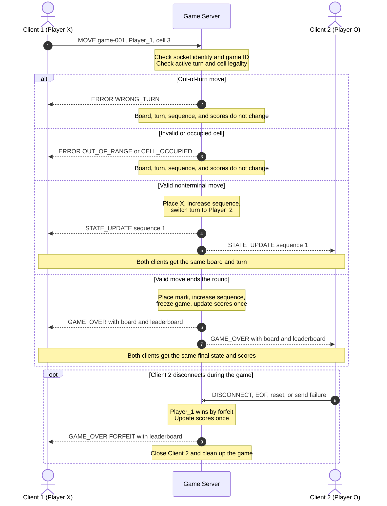

# Sprint 2 Concurrency Design

Forrest Fisher

## Server design

I will use Python's `selectors` module with non-blocking TCP sockets. The server will run one event loop that watches the listening socket and both player sockets. This lets the server work with both clients without getting stuck waiting for one of them.

I chose this instead of using a separate thread for each client. Tic-Tac-Toe messages are small, so one event loop is enough. It also makes the game state easier to protect because only one thread can change it.

The server will support two active players. It can still accept a third connection long enough to send `ERROR/SERVER_FULL` and close that extra socket. Messages will follow the newline-delimited JSON rules in [`protocol_blueprint.md`](protocol_blueprint.md).

The main server data will be:

| Data | What it stores |
|---|---|
| `ClientSession` | Socket, address, receive buffer, send buffer, alias, player ID, and closing status for one client. |
| `GameSession` | Game ID, board, active player, sequence number, connected players, game state, and whether scores were already recorded. |
| `leaderboard` | Wins, losses, draws, forfeits, and games played for each alias. |

Each client has its own receive and send buffers. The board and other shared game data belong to the server, not either client.

## Connection lifecycle

### Starting the server

1. Create an IPv4 TCP listening socket.
2. Set `SO_REUSEADDR`, bind to port `45700`, and call `listen()`.
3. Call `setblocking(False)` on the listening socket.
4. Register it with the selector for `EVENT_READ`.
5. Repeatedly call `selector.select(timeout=1.0)` in the main loop.

The selector waits for socket activity from any client instead of blocking on one specific client.

### Accepting players

When the listening socket is ready, the server calls `accept()` until it raises `BlockingIOError`. Every accepted client socket is immediately set to non-blocking mode and registered for `EVENT_READ`.

A connection is not assigned a player role until it sends a valid `CONNECT` message. The first valid client becomes `Player_1`/X and receives `LOBBY_WAIT`. The second becomes `Player_2`/O. The server then queues `GAME_START` for both players and makes Player 1 the first active player.

### Reading and writing

For each ready client socket, the event loop does the following:

- On `EVENT_READ`, call `recv()` until it would block. Add the bytes to that client's receive buffer and process every complete newline-terminated message.
- On `EVENT_WRITE`, call `send()` with bytes from that client's send buffer. If only part of the data is sent, keep the rest for the next writable event.
- Watch for `EVENT_WRITE` only when that client has data waiting to be sent.

The server will not use blocking `sendall()` on client sockets. This prevents a slow client from stopping the other client. Each send buffer has a 64 KiB limit so a disconnected or very slow client cannot use unlimited memory.

### Closing a connection

The same cleanup function handles:

- a valid `DISCONNECT` message;
- `recv()` returning `b""`, which means TCP EOF;
- `ConnectionResetError`, `BrokenPipeError`, `ConnectionAbortedError`, or timeout;
- a send buffer growing past its limit; and
- a normal close after the last queued message is sent.

Cleanup marks the client as closing first so the socket is not closed twice. It then unregisters and closes the socket, removes the client from the player map, and clears that client's buffers.

If the game was active, the remaining player wins by forfeit and receives `GAME_OVER`. If Player 1 was only waiting in the lobby, that slot is cleared without creating a winner. The listening socket stays open so another game can start.

## Keeping shared state safe

This design does not use `threading.Lock` because all shared data is owned by one event-loop thread. Each event handler finishes before the server handles the next socket event. No second client thread can change the board at the same time.

| Shared data | How it is protected |
|---|---|
| Board | Only the accepted-move handler can write a mark. |
| Active player | The turn check and turn switch happen in the same event handler. |
| Sequence number | It increases exactly once for each accepted move and before the update is sent. |
| Player/socket map | Connect, move, and disconnect events are handled one at a time. |
| Client buffers | Each socket has separate buffers that are only changed by the event loop. |
| Leaderboard | Only the first transition to `GAME_OVER` can update scores. |

The server processes a `MOVE` in this order:

1. Validate the NDJSON frame, JSON fields, `game_id`, and the player ID assigned to that socket.
2. Check that the sender is the active player.
3. Check that the cell is an integer from 1 through 9 and is empty.
4. Place the player's mark and increase the sequence number.
5. Check for a win and then a draw.
6. If the game continues, switch turns and create one `STATE_UPDATE`.
7. If the round ended, freeze the game, update scores once, and create one `GAME_OVER` with the leaderboard.
8. Serialize the result once and queue the same bytes for both connected clients before handling another event.

If a move fails before step 4, the server sends `ERROR` only to that client. The board, sequence number, turn, and scores stay unchanged. This prevents an invalid or out-of-turn move from damaging the game state.

## Client synchronization sequence



The two messages may not arrive at the exact same millisecond because TCP delivery time can vary. In this design, a synchronized broadcast means the server creates one state snapshot and queues the same serialized message for both clients before processing another move. Both copies have the same `game_id`, sequence number, board, turn, and scores.

Clients only replace their displayed state when a message has a newer sequence number. This protects them from displaying an older or duplicate update.

## Scores and leaderboard

Scores are kept in a server-memory dictionary using the player's normalized alias. The data stays available when one game is cleaned up, but it resets if the server program restarts. No database is planned for this version.

At the end of each round:

- For a win, the winner gets one win and the loser gets one loss.
- For a draw, both players get one draw.
- For a forfeit, the remaining player gets one win and the player who left gets one loss and one forfeit.
- Both players get one additional game played.

Only the change to `GAME_OVER` can update these numbers. A `scores_recorded` flag makes sure a later socket error during cleanup cannot count the same round twice.

The server sorts the leaderboard by wins, then losses, then alias. It includes the updated table in `GAME_OVER.payload.leaderboard`. The same serialized `GAME_OVER` is queued for both reachable clients. If one player already disconnected, the remaining player still receives the final result and updated scores.

Example after Player 1 wins:

```json
{
  "leaderboard": [
    {"rank": 1, "alias": "Forrest", "wins": 1, "losses": 0, "draws": 0, "forfeits": 0, "games_played": 1},
    {"rank": 2, "alias": "Guest", "wins": 0, "losses": 1, "draws": 0, "forfeits": 0, "games_played": 1}
  ]
}
```

## Broadcast rules

- Build a complete state snapshot only after the move has been accepted.
- Serialize that snapshot once, including its final newline delimiter.
- Queue the same bytes for Player 1 and Player 2 before processing another `MOVE`.
- Enable `EVENT_WRITE` for both clients with pending data.
- Keep unsent bytes buffered when `send()` writes only part of a message.
- Use a larger sequence number for every accepted move.
- Send `ERROR` only to the client that made the rejected request.
- If delivery to one client fails, keep the other client's queued update and handle the failure as a disconnect.

These rules let both clients share the same server-controlled game state without blocking the main loop.
