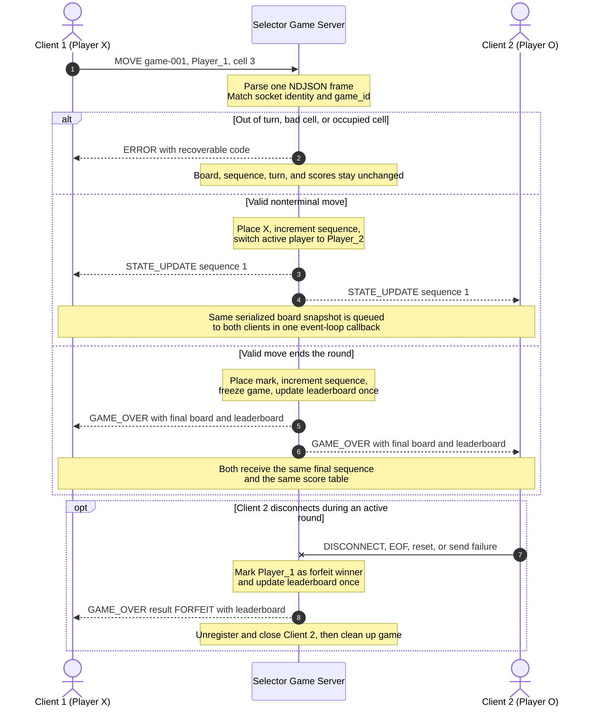

# Sprint 2 Concurrency Design

Forrest Fisher | CS 457 - Computer Networks | October 18, 2026

## 1. Architecture choice

I will use Python's `selectors` module and non-blocking TCP sockets. One server thread owns the listening socket, both player sockets, and all game data. The selector tells the event loop which sockets are ready to accept, read, or write, so the server never waits on one client while the other client needs service.

This design supports two active players at the same time. It can also briefly accept an extra connection so the server can send `ERROR/SERVER_FULL` and close it without disturbing the current game. I chose this over one thread per client because Tic-Tac-Toe has small messages and almost no CPU-heavy work. A single event loop is simpler and prevents two threads from changing the board at the same time.

The design uses the newline-delimited JSON protocol in [`protocol_blueprint.md`](protocol_blueprint.md). A single `recv()` result is never assumed to be one message.

## 2. Main server objects

The event-loop thread is the only code allowed to change these objects.

| Object | Main fields | Purpose |
|---|---|---|
| `Selector` | registered socket and `EVENT_READ`/`EVENT_WRITE` mask | Reports which sockets can make progress without blocking. |
| `ClientSession` | `socket`, address, receive buffer, send buffer, alias, `player_id`, closing flag | Keeps all connection-specific data separate. Each client has its own framing buffers. |
| `GameSession` | `game_id`, board, active player, sequence, player-to-socket map, state | Stores the one authoritative game. Clients never write this object directly. |
| `leaderboard` | alias mapped to wins, losses, draws, forfeits, and games played | Stores round results in server memory for the lifetime of the server process. |
| `next_game_number` | positive integer | Produces unique values such as `game-001` and `game-002`. |

The planned shapes are:

```python
ClientSession = {
    "socket": socket,
    "address": (host, port),
    "receive_buffer": bytearray(),
    "send_buffer": bytearray(),
    "alias": None,
    "player_id": None,
    "closing_after_flush": False,
}

GameSession = {
    "game_id": "game-001",
    "state": "WAITING_FOR_PLAYERS",
    "board": [None] * 9,
    "active_player": None,
    "sequence": 0,
    "players": {},
    "scores_recorded": False,
}

leaderboard = {
    "Forrest": {
        "wins": 0,
        "losses": 0,
        "draws": 0,
        "forfeits": 0,
        "games_played": 0,
    }
}
```

Aliases are unique among the two current players. Leaderboard rows are sorted by wins descending, losses ascending, and alias alphabetically so both clients display the same order.

## 3. Connection lifecycle

### Server startup

1. Create the IPv4 TCP listening socket.
2. Set `SO_REUSEADDR`, bind to port `45700`, and call `listen()`.
3. Call `setblocking(False)` on the listener.
4. Register the listener with the selector for `EVENT_READ`.
5. Enter the event loop and call `selector.select(timeout=1.0)` repeatedly.

The one-second timeout is only for housekeeping. It does not limit how quickly ready sockets are processed.

### Accept and registration

When the listening socket is readable, the server calls `accept()` until it raises `BlockingIOError`. Each new client socket is immediately set to non-blocking mode. A new `ClientSession` is created and registered for `EVENT_READ`.

The client is not a player until its first complete frame passes the exact `CONNECT` schema. The first accepted player becomes `Player_1`/X and receives `LOBBY_WAIT`. The second becomes `Player_2`/O. The event loop then queues `GAME_START` for both clients, with Player 1 as the active player. A third client is sent `ERROR/SERVER_FULL`, marked `closing_after_flush`, and closed after its error frame has been written.

### Active socket service

For every ready client, the loop handles readable work before writable work:

- **Read:** Call `recv()` repeatedly until it would block. Append bytes to that client's receive buffer, extract every complete newline-terminated frame, and dispatch the frames in arrival order.
- **Write:** Call `send()` only on the bytes currently at the front of that client's send buffer. Remove the number of bytes actually written. Partial writes stay buffered for the next writable event.
- **Interest mask:** Register `EVENT_WRITE` only while a send buffer is nonempty. This prevents a writable socket from making the event loop spin continuously.

The server does not use blocking `sendall()` on client sockets. A slow client therefore cannot stop the event loop from reading the other player's move. A per-client 64 KiB send-buffer limit prevents unlimited memory growth; exceeding it is treated as a lost connection.

### Disconnect and teardown

All of these events call the same idempotent `disconnect_client()` path:

- a valid `DISCONNECT` message;
- `recv()` returning `b""` for TCP EOF;
- `ConnectionResetError`, `BrokenPipeError`, `ConnectionAbortedError`, or timeout;
- a send-buffer overflow; or
- normal close after a final queued message is completely written.

The teardown function marks the session as closing first, so repeated error notifications cannot close it twice. It unregisters the socket, closes it, removes it from the connection and player maps, and discards its receive and send buffers. If a game was active, the reachable opponent wins by forfeit and receives `GAME_OVER`. If only Player 1 was waiting, the lobby slot is released without creating a win. The listener stays registered so the server can start another game.

## 4. State isolation and race prevention

This design does not need `threading.Lock` because there is only one event-loop thread. Selector callbacks are not coroutines and do not `await`; each callback runs to completion before the loop handles the next ready event. No client handler thread can modify shared memory at the same time.

The shared resources that would be vulnerable in a threaded design are protected by event-loop ownership here:

| Shared resource | Possible failure | Isolation rule |
|---|---|---|
| Board array | Two marks could be written into one cell. | Only the move transaction in the event-loop thread writes the board. |
| `active_player` | Both players could pass a turn check at once. | Turn validation and turn switching happen in one callback with no yield point. |
| Sequence number | Clients could receive conflicting versions. | It is incremented once inside the accepted-move transaction, before any broadcast is queued. |
| Player/socket map | A disconnect could race with a move. | Read, move, and disconnect events are handled one at a time by the same loop. |
| Client list and buffers | A broadcast could write to a closed socket entry. | The loop takes the current reachable-client list after state mutation and skips sessions already marked closing. |
| Leaderboard | A terminal result could be counted twice. | The game state changes to `GAME_OVER` before the leaderboard update, and only that transition may update scores. |

### Atomic move transaction

One complete `MOVE` frame is processed as this single event-loop transaction:

1. Validate NDJSON framing, JSON types, message fields, `game_id`, and socket-bound `player_id`.
2. Verify the game is in `PLAYER_TURN` and the sender equals `active_player`.
3. Verify `cell` is an integer from 1 through 9 and the board position is empty.
4. Write the player's mark and increment `sequence` exactly once.
5. Test for a win and then a draw.
6. For a nonterminal move, switch `active_player` and build one `STATE_UPDATE` snapshot.
7. For a terminal move, freeze the game, update the leaderboard once, and build one `GAME_OVER` snapshot containing the new leaderboard.
8. Serialize the snapshot once and append the same bytes to both reachable clients' send buffers before returning to `selector.select()`.

If validation fails before step 4, the server queues `ERROR` only for the sender. The board, sequence, active player, scores, and the other client's output buffer do not change. This is how out-of-turn moves are prevented from corrupting game state.

## 5. Turn and state synchronization

The server is authoritative. Client timestamps and client copies of the board are never used to approve a move. The TCP socket is bound to one player during `CONNECT`, so a client cannot impersonate the other player by changing `player_id` in JSON.



"Broadcast at the same time" means application-level synchronization, not identical packet arrival times. The event loop serializes one snapshot and queues it to both clients before processing any later game event. TCP may deliver the frames at slightly different wall-clock times, but both contain the same `game_id`, `sequence`, board, turn, and score data. Clients replace their local display only with a message whose sequence is newer than the one already shown.

## 6. Score and leaderboard synchronization

The leaderboard is a server-memory dictionary keyed by the normalized player alias. It survives individual game cleanup but resets if the server process restarts. This project does not claim persistent database storage.

At the end of a round, the event loop performs these updates before creating the final message:

- **Normal win:** winner gets one win; loser gets one loss; both get one game played.
- **Draw:** both players get one draw and one game played.
- **Forfeit:** reachable winner gets one win; departing player gets one loss and one forfeit; both get one game played.

The transition to `GAME_OVER` is the only place allowed to change these counters. A `scores_recorded` flag on the game session prevents a disconnect or failed send during cleanup from applying the result a second time.

The server then creates one sorted leaderboard array and includes it in the `GAME_OVER.payload.leaderboard` field. The identical serialized `GAME_OVER` frame is queued to both reachable players. If one player already disconnected, the remaining player receives the authoritative result; the server still records both players' counters. A failed delivery never rolls back a result that was already committed.

Example score data after Player 1's first win:

```json
{
  "leaderboard": [
    {
      "rank": 1,
      "alias": "Forrest",
      "wins": 1,
      "losses": 0,
      "draws": 0,
      "forfeits": 0,
      "games_played": 1
    },
    {
      "rank": 2,
      "alias": "Guest",
      "wins": 0,
      "losses": 1,
      "draws": 0,
      "forfeits": 0,
      "games_played": 1
    }
  ]
}
```

## 7. Broadcast and failure rules

- A state frame is created from an immutable snapshot after the mutation is complete.
- The server serializes that snapshot once, including the final newline delimiter.
- The same bytes are appended to both clients' send buffers in Player 1, then Player 2 order.
- No new `MOVE` frame is dispatched between those two queue operations.
- Nonempty send buffers enable `EVENT_WRITE`; partial sends never cause a frame to be rebuilt.
- A later update always has a larger `sequence`, so clients can detect stale or duplicate display data.
- If one send fails, the other client's queued copy remains valid. The failure becomes a disconnect event and follows the forfeit/cleanup rules.
- `ERROR` is not broadcast. It goes only to the client whose request failed because valid shared state did not change.

These rules keep both clients on one server-owned version of the game without blocking the main loop.

## 8. Implementation outline

```text
create non-blocking listener and selector
register listener for read events

while server is running:
    ready_events = selector.select(timeout=1.0)
    for key, mask in ready_events:
        if key is listener:
            accept every connection available without blocking
        else:
            if mask includes READ:
                receive available bytes and dispatch complete frames
            if session still exists and mask includes WRITE:
                flush available bytes from that client's send buffer
            update that socket's selector interest mask
```

No event handler performs blocking input, sleeps, waits for another client, or calls blocking `sendall()`. That is the main guarantee that two clients can stay connected and make progress independently.

## 9. Design checklist

- Two player sockets are monitored concurrently by one selector loop.
- The full lifecycle covers accept, registration, gameplay, error handling, and teardown.
- Shared board, turn, sequence, player map, buffers, and scores have explicit ownership rules.
- Out-of-turn and invalid moves return `ERROR` without mutating shared state.
- Valid state is serialized once and queued to both clients before another event is processed.
- The Mermaid diagram uses `sequenceDiagram` and includes valid, invalid, terminal, score, and disconnect paths.
- Score updates are applied once and included in the final broadcast to both reachable clients.
