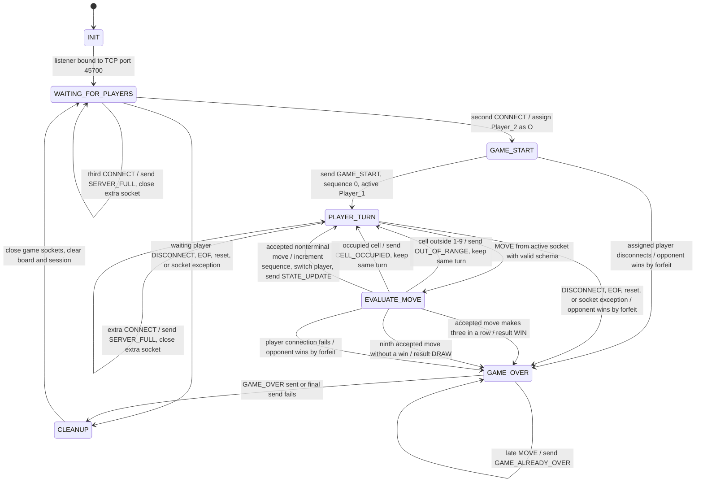

# Sprint 1 Game State Machine Specification

Forrest Fisher | CS 457 - Computer Networks | October 1, 2026

## 1. Purpose

This state machine controls one two-player Network Tic-Tac-Toe game. It is specific to the protocol in [`protocol_blueprint.md`](protocol_blueprint.md): Player 1 is X, Player 2 is O, X moves first, moves use cells 1 through 9, and the server is the only owner of the board.

The server processes one socket event at a time. A transition and all of its actions finish before the next message can change the game. This prevents two moves from updating the board at the same time.

## 2. Server-side state diagram



## 3. State responsibilities

| State | Server responsibility |
|---|---|
| `INIT` | Create the listening socket, enable address reuse, bind to TCP port `45700`, listen, and register it with the selector. No players exist yet. |
| `WAITING_FOR_PLAYERS` | Accept clients, validate `CONNECT`, assign the first accepted client as Player 1/X and the second as Player 2/O, and reject any extra client with `SERVER_FULL`. |
| `GAME_START` | Create the nine-cell empty board, set `sequence` to 0, make Player 1 active, and broadcast one `GAME_START` message to both players. |
| `PLAYER_TURN` | Accept only a `MOVE` from the socket bound to `active_player`. Reject out-of-turn, malformed, or unexpected messages without changing the board or turn. |
| `EVALUATE_MOVE` | Check the requested cell, place the correct mark for a valid move, increment the sequence once, and test the eight winning lines followed by the draw condition. |
| `GAME_OVER` | Freeze the board, set `active_player` to `null`, build one final `GAME_OVER` result, and send it to every client that is still reachable. |
| `CLEANUP` | Unregister and close game sockets, discard pending buffers, clear roles and board state, create the next game ID, and return to the lobby while leaving the listening socket open. |

## 4. Transition details

| Current state | Event and guard | Actions | Next state |
|---|---|---|---|
| `INIT` | Listener setup succeeds | Register listener on port `45700`. | `WAITING_FOR_PLAYERS` |
| `WAITING_FOR_PLAYERS` | First valid `CONNECT` | Bind socket to `Player_1`, assign X, send `LOBBY_WAIT`. | `WAITING_FOR_PLAYERS` |
| `WAITING_FOR_PLAYERS` | Second valid `CONNECT` | Bind socket to `Player_2`, assign O. | `GAME_START` |
| `WAITING_FOR_PLAYERS` | Extra connection after two assignments | Send `ERROR/SERVER_FULL`; close only the extra socket. | `WAITING_FOR_PLAYERS` |
| `GAME_START` | Both assigned sockets are connected | Broadcast empty board, roles, sequence 0, and active Player 1. | `PLAYER_TURN` |
| `PLAYER_TURN` | Validly framed `MOVE` from active player's socket | Validate exact schema and session identifiers. | `EVALUATE_MOVE` |
| `PLAYER_TURN` | `MOVE` from inactive player's socket | Send `ERROR/WRONG_TURN`; do not change board, sequence, or turn. | `PLAYER_TURN` |
| `PLAYER_TURN` | Bad JSON, bad types, bad fields, or unexpected message | Send the matching `ERROR`; keep the current game state. | `PLAYER_TURN` |
| `EVALUATE_MOVE` | `cell` is not an integer from 1 through 9 | Send `ERROR/OUT_OF_RANGE`; do not consume the turn. | `PLAYER_TURN` |
| `EVALUATE_MOVE` | Board cell is occupied | Send `ERROR/CELL_OCCUPIED`; do not consume the turn. | `PLAYER_TURN` |
| `EVALUATE_MOVE` | Valid move with no win and an open cell remaining | Place mark, increment sequence, switch active player, broadcast `STATE_UPDATE`. | `PLAYER_TURN` |
| `EVALUATE_MOVE` | Valid move completes a row, column, or diagonal | Place mark, increment sequence, store `WIN` and winner. | `GAME_OVER` |
| `EVALUATE_MOVE` | Valid ninth move does not win | Place mark, increment sequence, store `DRAW` and null winner. | `GAME_OVER` |
| Any assigned-player state | Intentional `DISCONNECT` | Mark `PLAYER_QUIT`; the connected opponent wins by forfeit. | `GAME_OVER` or `CLEANUP` if no opponent exists |
| Any assigned-player state | `recv()` returns `b""` | Treat EOF once as `CLIENT_DISCONNECTED`; mark `CONNECTION_LOST`. | `GAME_OVER` or `CLEANUP` |
| Any assigned-player state | Reset, broken pipe, timeout, or connection exception | Convert exception to `CLIENT_DISCONNECTED`; do not crash the server. | `GAME_OVER` or `CLEANUP` |
| `GAME_OVER` | Final message delivered or delivery fails | Freeze input and release game resources. | `CLEANUP` |
| `CLEANUP` | All game resources released | Clear session and wait for a new first player. | `WAITING_FOR_PLAYERS` |

## 5. Move evaluation rules

The server checks a `MOVE` in this exact order:

1. The frame is valid NDJSON and no more than 4096 bytes.
2. The object exactly matches the `MOVE` schema.
3. `game_id` matches the current game.
4. `player_id` matches the identity bound to the sending socket.
5. The sender equals `active_player`.
6. `cell` is an integer from 1 through 9.
7. The selected board location is `null`.
8. The server writes X for Player 1 or O for Player 2.
9. The server increments `sequence` once.
10. The server checks these eight winning lines:

```text
(1,2,3) (4,5,6) (7,8,9)
(1,4,7) (2,5,8) (3,6,9)
(1,5,9) (3,5,7)
```

11. If there is no win, the server checks whether all nine cells are occupied.
12. If the game is still active, the server switches players and broadcasts `STATE_UPDATE`.

Checks 1 through 7 can reject the request. A rejection never places a mark, increments `sequence`, or changes `active_player`.

## 6. Disconnect behavior by state

| State | Disconnect result |
|---|---|
| `WAITING_FOR_PLAYERS` with only Player 1 | Release Player 1's slot and return to an empty lobby. There is no winner because the game did not start. |
| `GAME_START` | If one assigned client is lost before the start message finishes, declare the reachable opponent the forfeit winner. |
| `PLAYER_TURN` | Declare the connected opponent the winner by forfeit, even if the disconnected player was not active. |
| `EVALUATE_MOVE` before board mutation | Do not apply the pending move; opponent wins by forfeit. |
| `EVALUATE_MOVE` after an accepted terminal move | Preserve the normal win/draw result. Cleanup handles any failed final send. |
| `GAME_OVER` | Keep the already decided result and continue cleanup. |
| `CLEANUP` | Ignore duplicate disconnect notifications because the socket is already marked closed. |

Graceful `DISCONNECT`, TCP FIN/EOF, TCP reset, broken pipe, connection abort, and timeout all reach the same cleanup path. The difference is recorded only in the `GAME_OVER.payload.reason` and server log.

## 7. State invariants

- `WAITING_FOR_PLAYERS` contains zero or one assigned player until the second valid `CONNECT` arrives.
- `GAME_START` always assigns Player 1/X and Player 2/O and starts at sequence 0.
- `PLAYER_TURN` always has exactly one active player.
- `EVALUATE_MOVE` is entered only for the active player's schema-valid `MOVE`.
- Only `EVALUATE_MOVE` may change a board cell or increment `sequence`.
- `GAME_OVER` has a frozen board and `active_player = null`.
- Every active game reaches `CLEANUP` after a win, draw, forfeit, or unrecoverable socket error.
- `CLEANUP` never closes the listening socket, so a later round can begin.

## 8. Example error paths

### Out-of-turn move

Player 2 sends a schema-valid `MOVE` while Player 1 is active. The server remains in `PLAYER_TURN`, sends `ERROR` with code `WRONG_TURN` only to Player 2, and leaves the sequence, board, and active player unchanged.

### Occupied cell

The active player requests cell 3 after it has already been used. The server briefly enters `EVALUATE_MOVE`, sends `ERROR` with code `CELL_OCCUPIED`, and returns to `PLAYER_TURN` with the same player still active.

### Abrupt client loss

Player 1's process is killed during a game. The server receives EOF or a socket exception, creates one internal disconnect event, chooses Player 2 as the forfeit winner, sends `GAME_OVER` with reason `CONNECTION_LOST` to Player 2, and then clears the session in `CLEANUP`.
